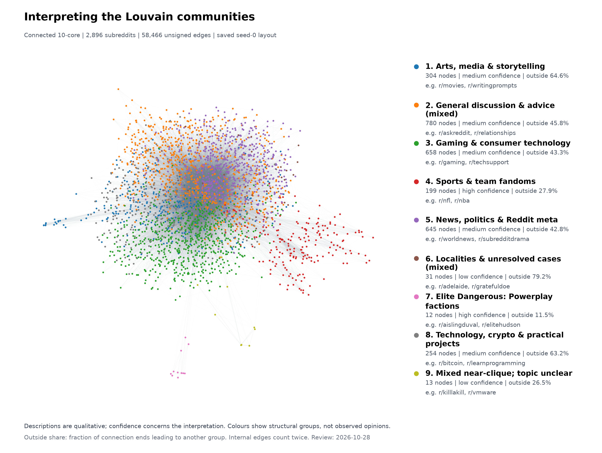

# Interpreting the nine Louvain communities

Reviewed 2026-10-28. These descriptions concern the saved body-link connected 10-core: 2,896 subreddits, 58,466 undirected edges, nine communities.

Sports and the small Elite Dangerous group have the clearest inspected themes. The larger communities combine related subjects with general discussion, support or Reddit meta-commentary. Two small groups remain mixed or unclear. These are qualitative descriptions of a structural partition, not measured topic purity.



[PDF figure](figures/community_interpretation.pdf). Colours and coordinates match the original plot. The legend gives two example subreddits per community. Figure numbers are saved IDs plus one; the mapping is retained in the table below.

## Community profiles

Internal edges join two members of a group; boundary edges join a member to another group. Outside share is `boundary / (2 * internal + boundary)`: the fraction of the group's incident **edge ends** crossing its boundary. It is unweighted and descriptive, without a null-model comparison. Boundary edges appear once in each endpoint group's row.

| Figure / saved ID | Interpretation | Confidence | Nodes | Internal edges | Boundary edges | Outside share |
| --- | --- | --- | ---: | ---: | ---: | ---: |
| 1 / 0 | Arts, media & storytelling | medium | 304 | 1,940 | 7,072 | 64.6% |
| 2 / 1 | General discussion & advice (mixed) | medium | 780 | 8,964 | 15,179 | 45.8% |
| 3 / 2 | Gaming & consumer technology | medium | 658 | 7,311 | 11,146 | 43.3% |
| 4 / 3 | Sports & team fandoms | high | 199 | 2,090 | 1,619 | 27.9% |
| 5 / 4 | News, politics & Reddit meta | medium | 645 | 9,390 | 14,039 | 42.8% |
| 6 / 5 | Localities & unresolved cases (mixed) | low | 31 | 68 | 518 | 79.2% |
| 7 / 6 | Elite Dangerous: Powerplay factions | high | 12 | 58 | 15 | 11.5% |
| 8 / 7 | Technology, crypto & practical projects | medium | 254 | 1,379 | 4,740 | 63.2% |
| 9 / 8 | Mixed near-clique; topic unclear | low | 13 | 75 | 54 | 26.5% |

The Elite Dangerous group's outside share is 11.5%; sports is 27.9%. By comparison, the locality/case mixture has 79.2% outside. The 13-node unclear group is almost complete internally, yet its names do not establish one topic. Structural separation and interpretable subject matter answer different questions.

Confidence refers to the proposed description: high means consistent inspected names with supporting spot-check evidence; medium means a visible theme with substantial mixing; low means ambiguity or inadequate verification. These grades are reviewer judgments, not probabilities or statistical estimates.

## Evidence for each description

### 1. Arts, media & storytelling (saved ID 0)

Movies, music, books, television and creative writing dominate the central members. The random sample adds music genres and fiction fandoms such as popheads, trap, asoiaf and the100. This supports a broad media and storytelling label. iama is a general interview hub, while lfg and retrofuturism broaden the interpretation; this is not a single genre.

**Most internally connected:** `iama` (157), `writingprompts` (103), `movies` (87), `videos` (69), `tipofmytongue` (67), `music` (66), `books` (59), `fantheories` (52), `hiphopheads` (48), `television` (45), `starwars` (43), `fantasy` (40), `asksciencefiction` (39), `whowouldwin` (39), `writing` (39). Numbers count neighbours within this group.

**Random remainder sample:** `asoiaf`, `iguanadonseverywhere`, `lfg`, `octobersveryown`, `popheads`, `rational`, `retrofuturism`, `synthesizers`, `the100`, `trap`.

### 2. General discussion & advice (mixed) (saved ID 1)

askreddit, pics and funny sit alongside personal advice and self-disclosure forums such as legaladvice, relationships and offmychest. The random sample ranges from gradadmissions and mentalillness to occult and pittsburgh. General discussion and advice describe the central strands, but the diversity does not support a narrow subject label.

**Most internally connected:** `askreddit` (502), `pics` (251), `funny` (212), `legaladvice` (211), `relationships` (180), `tifu` (159), `offmychest` (157), `adviceanimals` (156), `self` (153), `showerthoughts` (152), `nostupidquestions` (143), `science` (142), `depression` (137), `lifeprotips` (137), `hailcorporate` (131). Numbers count neighbours within this group.

**Random remainder sample:** `artisanvideos`, `fitmeals`, `gradadmissions`, `karmaconspiracy`, `lightbulb`, `marijuana`, `mentalillness`, `occult`, `onetruegod`, `pittsburgh`.

### 3. Gaming & consumer technology (saved ID 2)

gaming, games, leagueoflegends, overwatch and hearthstone anchor the gaming strand; pcmasterrace, techsupport, buildapc and android add devices and support. arma, kotor, nintendoswitch, ssbm and overclocking in the random sample reinforce these themes. outoftheloop, copypasta, help and postpreview show that memes and Reddit support also belong to this group.

**Most internally connected:** `gaming` (272), `games` (211), `outoftheloop` (202), `pcmasterrace` (194), `techsupport` (163), `leagueoflegends` (148), `overwatch` (125), `buildapc` (124), `copypasta` (122), `help` (121), `globaloffensive` (118), `android` (117), `pcgaming` (113), `hearthstone` (108), `postpreview` (105). Numbers count neighbours within this group.

**Random remainder sample:** `arma`, `harambe`, `kotor`, `moto360`, `nintendoswitch`, `overclocking`, `pitchforkemporium`, `rsoc`, `shittykickstarters`, `ssbm`.

### 4. Sports & team fandoms (saved ID 3)

The central members name sports leagues and teams, including nfl, nba, baseball, hockey, denverbroncos and seahawks. The random sample adds habs, mls, padres and other teams. A first-person charity-contest announcement also connects the less obvious charitablebets member to fantasy football [S3]. The shared sports theme is clear in both inspected subsets; it does not imply that rival fan groups agree.

**Most internally connected:** `nfl` (77), `nba` (59), `baseball` (58), `hockey` (54), `charitablebets` (52), `collegebasketball` (50), `denverbroncos` (50), `seahawks` (49), `greenbaypackers` (44), `minnesotavikings` (43), `patriots` (43), `chargers` (41), `chibears` (41), `eagles` (41), `falcons` (41). Numbers count neighbours within this group.

**Random remainder sample:** `baseballtradedeadline`, `habs`, `kansascitychiefs`, `mavericks`, `mls`, `nbacirclejerk`, `newyorkmets`, `oaklandraiders`, `onthefarm`, `padres`.

### 5. News, politics & Reddit meta (saved ID 4)

worldnews, news, politics, conspiracy, the_donald and shitliberalssay mix with subredditdrama, drama, circlebroke and other forums about Reddit itself. The random sample includes armenia, podemos, mhocpress, shadowban and solotravel. This is a mixture of news, political discussion and meta-commentary. The names suggest several political perspectives; ideological composition was not independently verified.

**Most internally connected:** `subredditdrama` (381), `worldnews` (274), `conspiracy` (233), `shitliberalssay` (231), `drama` (215), `the_donald` (215), `news` (212), `todayilearned` (212), `politics` (195), `circlejerkcopypasta` (177), `explainlikeimfive` (169), `circlebroke` (168), `subredditcancer` (162), `bestofoutrageculture` (159), `changemyview` (159). Numbers count neighbours within this group.

**Random remainder sample:** `armenia`, `gunsarecool`, `jimmiesclub`, `mhocpress`, `niceguys`, `oppression`, `podemos`, `shadowban`, `shitpost`, `solotravel`.

### 6. Localities & unresolved cases (mixed) (saved ID 5)

All 31 names were inspected. Australian and US locality names occur alongside unresolvedmysteries, gratefuldoe, lylestevik and unexplainedphotos. The current gratefuldoe rules confirm a focus on unidentified-person cases [S1], but the LyleStevik and BNEStrong lookups yielded no usable primary page. blog, everything and volunteer further weaken a single-topic reading. The label records two visible strands; it does not explain why they link.

**Most internally connected:** `unresolvedmysteries` (8), `adelaide` (7), `gratefuldoe` (7), `melbourne` (7), `northcarolina` (7), `sydney` (7), `brisbane` (6), `lylestevik` (6), `nationalpark` (6), `auslaw` (5), `blog` (5), `bnestrong` (5), `raleigh` (5), `volunteer` (5), `albuquerque` (4). Numbers count neighbours within this group.

**All remaining members:** `buffalo`, `charlotte`, `cincinnati`, `everything`, `florida`, `madisonwi`, `maryland`, `miami`, `newmexico`, `perth`, `southcarolina`, `triangle`, `tropicalweather`, `unexplainedphotos`, `virginia`, `wisconsin`.

All 31 member names were inspected.

### 7. Elite Dangerous: Powerplay factions (saved ID 6)

All 12 names form a consistent game-faction pattern: aislingduval, eliteantal, elitehudson, elitelavigny, elitewinters, elitecg, elitemahon, elitepatreus, elitetorval, imperialhighcommand, kumocrew and elitesirius. A July 2015 player coordination post for Elite Dangerous Powerplay links directly to r/AislingDuval [S2], providing evidence from the observation period. The broad game context is well supported; each faction was not independently verified, and links alone do not establish alliances.

**Most internally connected:** `aislingduval` (11), `eliteantal` (11), `elitehudson` (11), `elitelavigny` (11), `elitewinters` (10), `elitecg` (9), `elitemahon` (9), `elitepatreus` (9), `elitetorval` (9), `imperialhighcommand` (9), `kumocrew` (9), `elitesirius` (8). Numbers count neighbours within this group.

All 12 member names were inspected.

### 8. Technology, crypto & practical projects (saved ID 7)

bitcoin, dogecoin and cryptocurrency occur with learnprogramming, sysadmin, webdev, raspberry_pi and programming. forhire, cscareerquestions and startups add work and exchange. The random sample includes asknetsec and web_design, but also gardening, homeimprovement, diyaudio and uber. A broad technology, crypto and practical-project label fits better than a claim that every member concerns cryptocurrency.

**Most internally connected:** `bitcoin` (70), `learnprogramming` (67), `dogecoin` (53), `sysadmin` (49), `webdev` (36), `diy` (35), `forhire` (34), `cscareerquestions` (33), `raspberry_pi` (32), `darknetmarkets` (31), `programming` (30), `startups` (30), `dogemarket` (29), `cryptocurrency` (28), `math` (28). Numbers count neighbours within this group.

**Random remainder sample:** `asknetsec`, `diyaudio`, `gardening`, `graphic_design`, `homeimprovement`, `itcareerquestions`, `jobs4bitcoins`, `selfdrivingcars`, `uber`, `web_design`.

### 9. Mixed near-clique; topic unclear (saved ID 8)

All 13 names were inspected. They range from killlakill and thewire to vmware, nvidiashield, voxelgamedev and iupui, with several opaque names. The four targeted opaque-name checks yielded no usable page. The graph contains 75 of the 78 possible internal edges (96.2%), but this density does not establish a shared subject. Keep the topical interpretation unclear; bot activity, common ownership and coordinated linking remain untested explanations.

**Most internally connected:** `cqb` (12), `iupui` (12), `killlakill` (12), `mbotandgtron` (12), `nomina` (12), `nvidiashield` (12), `pears` (12), `pmmodi` (12), `thewire` (12), `vmware` (12), `cbf4life` (10), `iwishiwaslucky` (10), `voxelgamedev` (10). Numbers count neighbours within this group.

All 13 member names were inspected.

## Method, source checks and limits

The partition is the saved unsigned, unweighted Louvain result (seed 0). Rank members by within-community degree descending, breaking ties by name. Inspect the top 15 and ten randomly selected remaining members for each group larger than 40. Sort the sampling population alphabetically and reset `random.Random(0)` for each group. Inspect all names for groups of at most 40. This covers 206 distinct member names; it does not classify every member of the six large groups. The listed samples were reviewed before writing the annotations.

All external checks were made on 2026-10-28. Nine distinct subreddit targets were checked, below the cap of 15; a check can include search and a direct page attempt. Failed retrievals and unrelated results contribute no semantic evidence. S1 is contemporary and S3 postdates the dataset; neither reconstructs a 2014-2017 sidebar. S2 is a primary player post from the observation period. No paid API, model training, new community detection or new layout calculation was used.

| Subreddit target | Source or attempted page | Outcome and time relevance |
| --- | --- | --- |
| `gratefuldoe` | [S1: current subreddit rules](https://www.reddit.com/r/gratefuldoe/about/) | Retrieved; unidentified-person case focus. Contemporary, not an archived sidebar. |
| `aislingduval` | [S2: player coordination post, 2015-07-16](https://steamcommunity.com/app/359320/discussions/0/535150948597144836/) | Retrieved historical primary post; explicitly links the subreddit to Powerplay. Direct wiki/old-Reddit retrieval failed. |
| `charitablebets` | [S3: contest organiser's post, 2021-11-18](https://www.reddit.com/r/fantasyfootball/comments/qwv5cw/) | Search-index text of a primary post connects it to fantasy-football charity contests. Postdates the dataset; direct about-page retrieval failed. |
| `lylestevik` | [Attempted subreddit page](https://www.reddit.com/r/LyleStevik/about/) | No usable primary page from retrieval or targeted search. A secondary result was excluded; identity remains unverified here. |
| `bnestrong` | [Attempted subreddit page](https://www.reddit.com/r/BNEStrong/about/) | Retrieval failed; targeted search found no usable result. No meaning assigned. |
| `mbotandgtron` | [Attempted subreddit page](https://www.reddit.com/r/mbotandgtron/) | Retrieval failed and search gave no usable match. No meaning assigned. |
| `nomina` | [Attempted subreddit page](https://www.reddit.com/r/nomina/) | Retrieval failed and search gave no usable match. No meaning assigned. |
| `cbf4life` | [Attempted subreddit page](https://www.reddit.com/r/cbf4life/) | Retrieval failed and search gave no usable match. No meaning assigned. |
| `iwishiwaslucky` | [Attempted subreddit page](https://www.reddit.com/r/iwishiwaslucky/) | Retrieval failed and search gave no usable match. No meaning assigned. |

Names and a small sample can conceal subtopics, satire and changes of purpose. The dataset covers historical hyperlinks, not membership overlap or original post text; its numeric text-property vectors do not supply that text ([SNAP dataset description](https://snap.stanford.edu/data/soc-RedditHyperlinks.html), checked 2026-10-28). The core covers a selected subset of Reddit. These labels do not establish shared ideology, agreement, observed opinions or the causes of links. They describe this one partition; stability across Louvain seeds was not tested.

## Reproduction and provenance

Run from a checkout with the three matching saved inputs available:

```bash
uv run python scripts/interpret_communities.py
```

The script also accepts `--graph`, `--communities`, `--layout`, `--report` and `--figure-dir`. The graph, labels and layout are ignored local artifacts, so a fresh checkout needs those exact files copied or independently reproduced. It verifies input hashes, unique node rows, labels, coordinates and graph counts before writing. It performs no network requests. Annotations and source notes are reviewed constants in the script; new artifacts require a fresh semantic review.

Code baseline: `7f205f43dd93b0ae7809d07728521408ffc156fe`. These hashes identify the actual local inputs independently of that Git revision:

| Input | SHA-256 |
| --- | --- |
| `data/processed/core.graphml` | `84be8ddab207881a7fd770925a34346ee4464070c6a40294a2d135e61c3314e2` |
| `data/processed/communities.csv` | `649b32e25d002eeda771311adca840f4e0d8277b6c9b4b51637bab338fae78d1` |
| `results/topology/core_layout.csv` | `fb23cade7454280e1790cd7aebd56d1b8d42491bf3fdc1a70925a39a12036228` |

Checks: nine groups total 2,896 nodes; 31,275 internal edges plus 27,191 distinct between-group edges equal 58,466. Twice the internal edge total plus all boundary counts equals twice the full edge count. Every node's saved ID agrees across GraphML, community CSV and layout CSV. The regeneration preserves node positions and colour assignments.

[S1]: https://www.reddit.com/r/gratefuldoe/about/
[S2]: https://steamcommunity.com/app/359320/discussions/0/535150948597144836/
[S3]: https://www.reddit.com/r/fantasyfootball/comments/qwv5cw/
